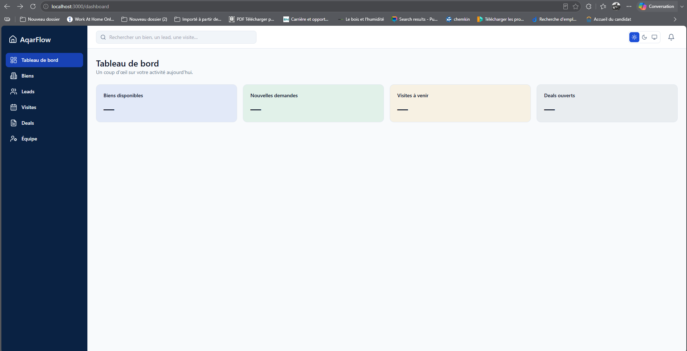
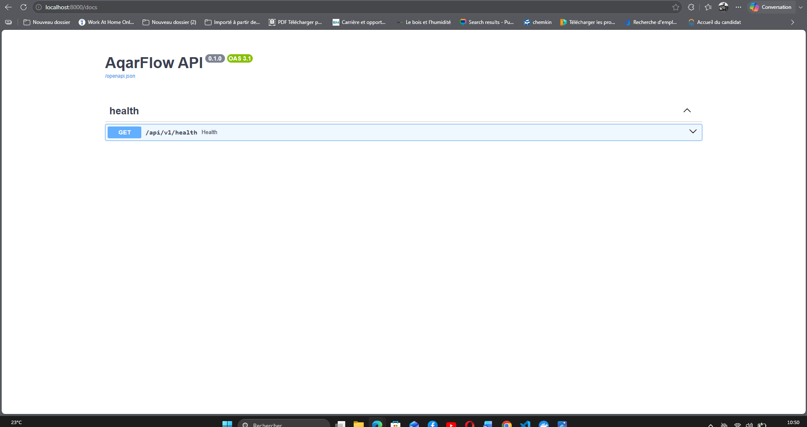
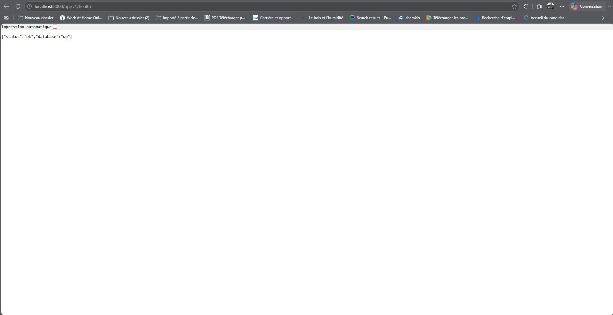
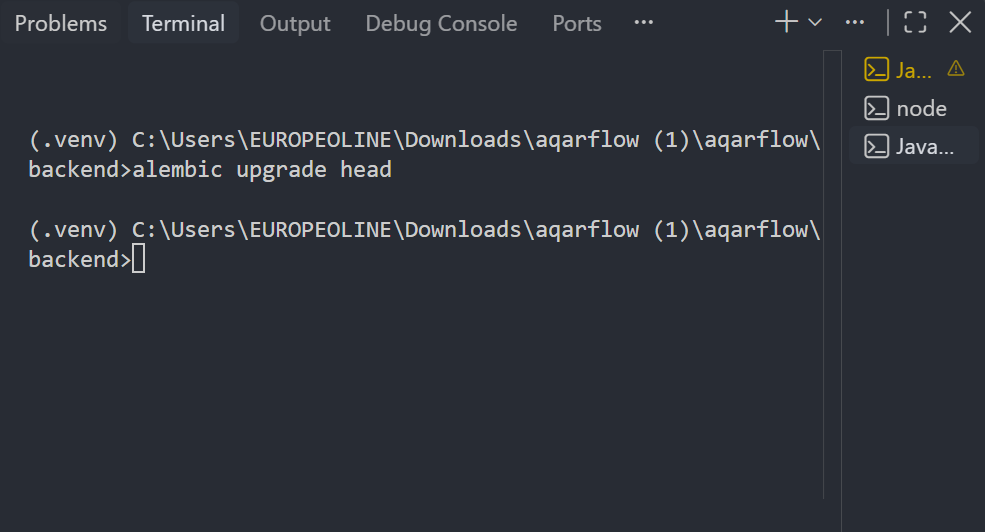
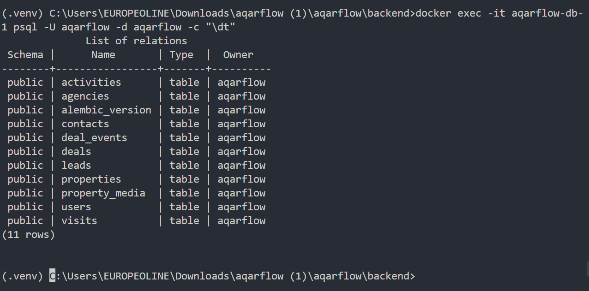

# Day 1 — Foundation

The frontend, the API and the PostgreSQL database run locally, and the database schema is created by Alembic migrations.

## Frontend and dashboard

The frontend starts with `npm run dev` and displays the dashboard at `http://localhost:3000/dashboard`.

## API documentation

The API starts with `uvicorn app.main:app --reload`, and its interactive documentation is available at `http://localhost:8000/docs`.

## Database connection

The health endpoint confirms that the API reaches PostgreSQL: `http://localhost:8000/api/v1/health` returns `{"status":"ok","database":"up"}`.

## Database schema

`alembic upgrade head` creates the schema without errors.

PostgreSQL then contains the 10 application tables plus `alembic_version`.

## Layout and navigation

The layout has a sidebar, a top bar and six navigation items (see the dashboard screenshot above).

## Known limitations

Only `/dashboard` has a page so far. The other five linked routes are not implemented yet.
