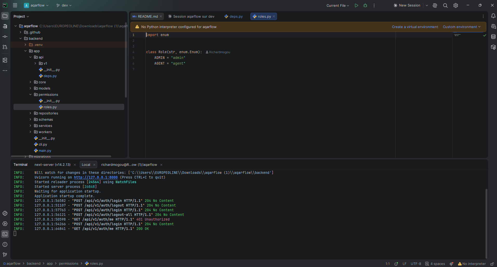

# Day 2 — Authentication, roles and protected routes

Users can sign in to their agency workspace. The API exposes login, current-user, logout and logout-all endpoints. Protected workspace routes redirect unauthenticated visitors to `/login`. Backend role checks enforce Admin and Agent permissions. Interface preferences (locale and theme) persist across page loads.

## Acceptance criteria covered

| Criterion | Status |
|---|---|
| Agency Admin can sign in securely | ✅ |
| Protected workspace pages reject unauthenticated requests | ✅ |
| Agent can sign in and access only permitted areas | ✅ |
| Role checks enforced by the backend, not only by hiding frontend buttons | ✅ |

---

## Login page

The login page is available at `http://localhost:3000/login`. It accepts an email and a password, and includes a language switch (EN / FR) and a theme switch (light / dark / system).

---

## Authentication API

The authentication endpoints are available in the interactive API documentation at `http://localhost:8000/docs`.

### Login

`POST /api/v1/auth/login` receives the email and the password as JSON. On success it sets a secure `httpOnly` session cookie (`aqarflow_session`) and returns HTTP 204. Invalid credentials return HTTP 401.

### Current user

`GET /api/v1/auth/me` returns the signed-in user with their `id`, `agency_id`, `full_name`, `email` and `role` (HTTP 200). An expired or missing session returns HTTP 401.

### Logout

`POST /api/v1/auth/logout` revokes the current session and clears the session cookie (HTTP 204).

### Logout from all sessions

`POST /api/v1/auth/logout-all` revokes all active sessions for the authenticated user (HTTP 204).

---

## Protected routes

The Next.js middleware (`middleware.ts`) intercepts every request to the workspace routes listed below. If the session cookie is absent the visitor is redirected to `/login?next=<original-path>` and returned to their destination after a successful sign-in.

Protected routes: `/dashboard`, `/properties`, `/leads`, `/visits`, `/deals`, `/team`.

On the backend, `get_current_session` validates the session token against the database on every protected API call. An invalid, expired or revoked token returns HTTP 401 before any business logic runs.

---

## Role-based access control

Two roles are implemented: `admin` and `agent`. The `require_role` dependency on the backend rejects requests from users whose role is not in the allowed set with HTTP 403, independently of any frontend visibility rules.

---

## CSRF protection

All mutating endpoints (`POST`, `PATCH`, `DELETE`) require the custom header `X-Requested-With: aqarflow`. A custom header cannot be sent cross-origin without a CORS preflight, which forged forms cannot pass. The frontend `api()` helper sends this header automatically on every request.

---

## Interface preferences

The locale (EN / FR) and theme (light / dark / system) are persisted in cookies and applied server-side on every page load, with no flash of unstyled or untranslated content.

---

## Known limitations

- Frontend workspace pages use mock data; the backend is not yet called for properties, leads or visits.
- Agent-specific sidebar restrictions are enforced by the backend `require_role` dependency but the sidebar navigation does not yet hide admin-only items for agents.
- Password reset and email verification are not part of the MVP scope.
