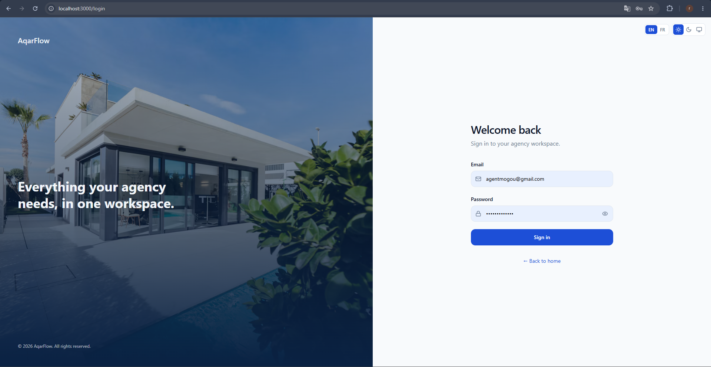
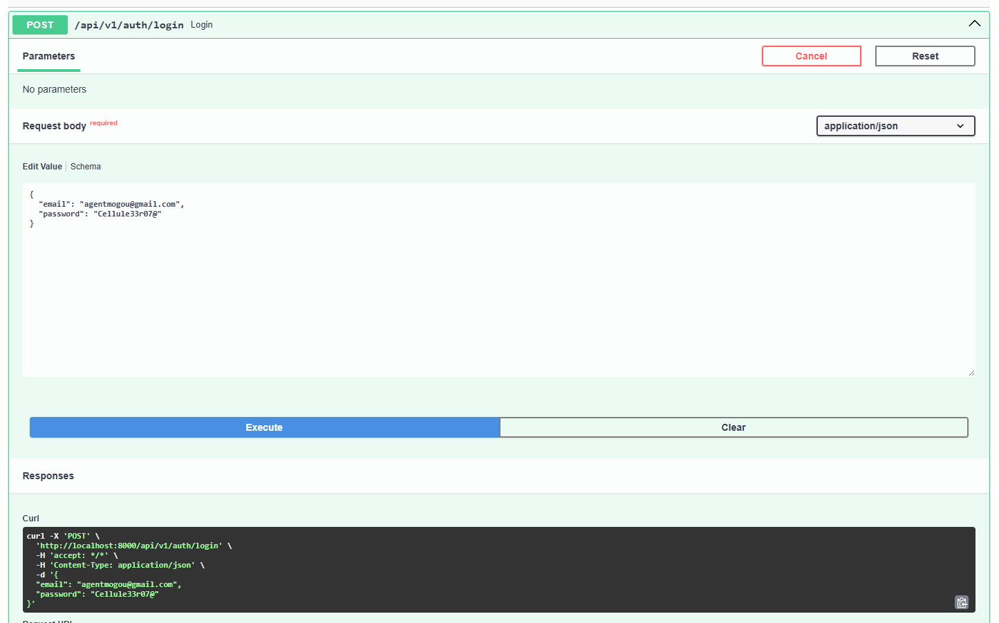
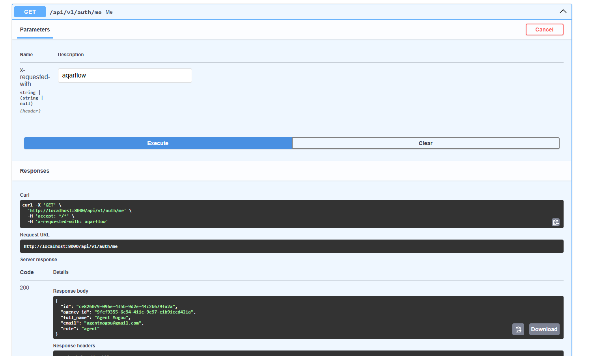
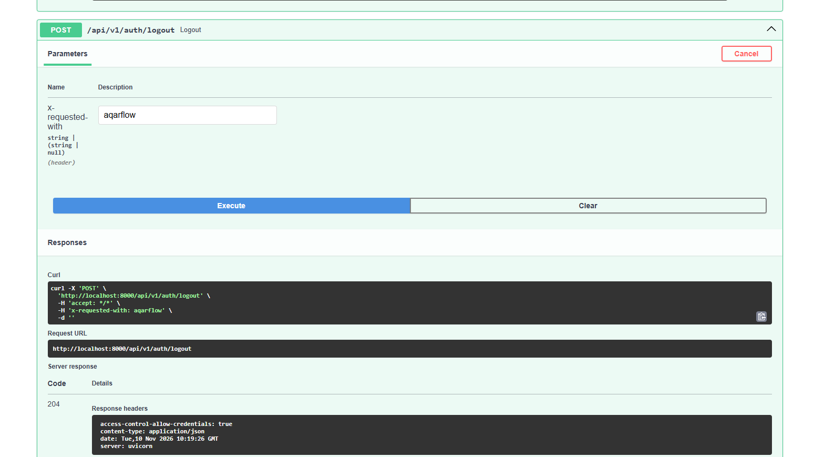
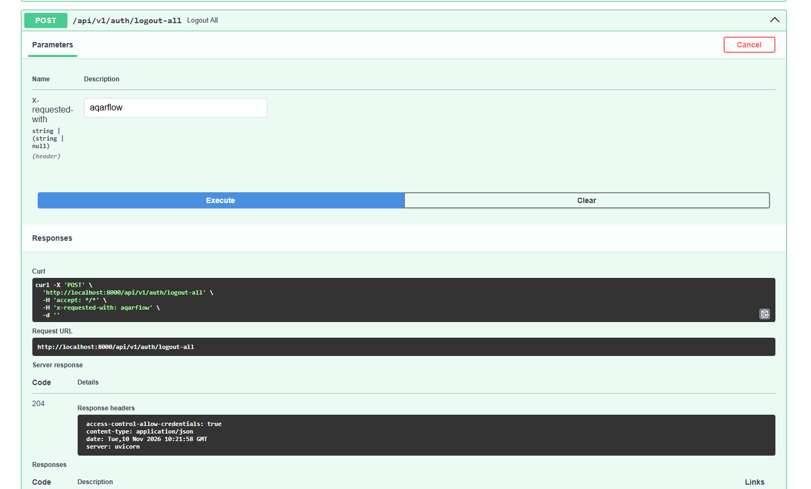

# Day 2 — Authentication, roles and protected routes

Users can sign in to their agency workspace. The API exposes login, current-user, logout and logout-all endpoints. Protected workspace routes redirect unauthenticated visitors to `/login`, and backend role checks enforce Admin and Agent permissions.

## Login page

The login page is available at `http://localhost:3000/login`. It accepts an email and a password, and includes a language switch (EN / FR), a theme switch (light / dark / system) and a one-click demo account button.

## Authentication API

The authentication endpoints are available in the interactive API documentation at `http://localhost:8000/docs`.

### Login

`POST /api/v1/auth/login` receives the email and the password as JSON and sets a secure `httpOnly` session cookie.

### Current user

After signing in, `GET /api/v1/auth/me` returns the signed-in user with their role (HTTP 200).

### Logout

`POST /api/v1/auth/logout` ends the current session (HTTP 204).

### Logout from all sessions

`POST /api/v1/auth/logout-all` ends all active sessions for the user (HTTP 204).

## CSRF protection

All mutating endpoints (`POST`, `PATCH`, `DELETE`) require the `X-Requested-With: aqarflow` header. The login endpoint is intentionally exempt — it has no session to protect. Swagger exposes the header as a parameter field for testing.

## Role-based access control

Two roles are implemented: `admin` and `agent`. The backend enforces role checks via a `require_role` dependency. The frontend middleware (`middleware.ts`) redirects unauthenticated requests on all workspace routes (`/dashboard`, `/properties`, `/leads`, `/visits`, `/deals`, `/team`) to `/login?next=…`.

## Interface preferences

The locale (EN / FR) and theme (light / dark / system) are persisted in cookies and applied on every page load without a flash of unstyled content.

## Known limitations

- Frontend workspace pages still use mock data; the backend is not yet called for properties, leads or visits.
- Agent-specific route restrictions (hiding admin-only pages) are enforced by the backend `require_role` dependency but not yet reflected in the sidebar navigation.
- Password reset and email verification are not implemented in the MVP.
