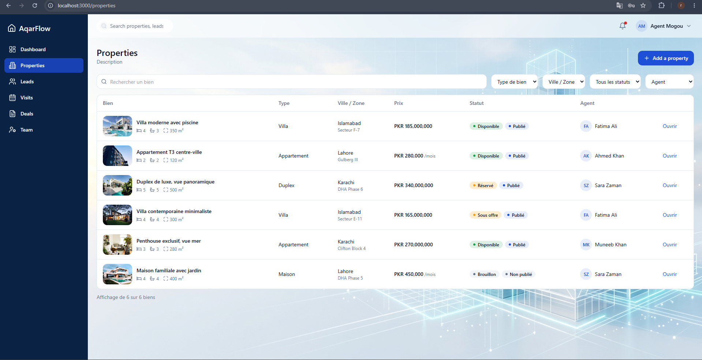
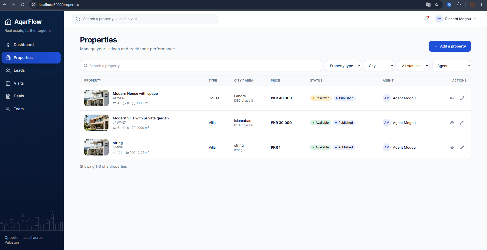
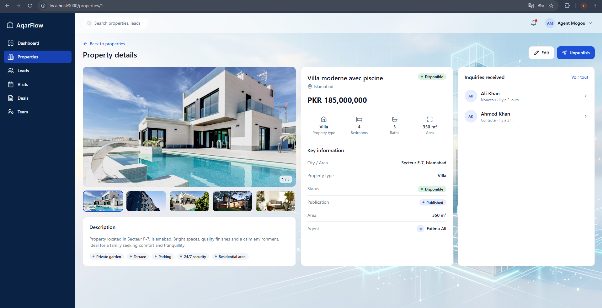
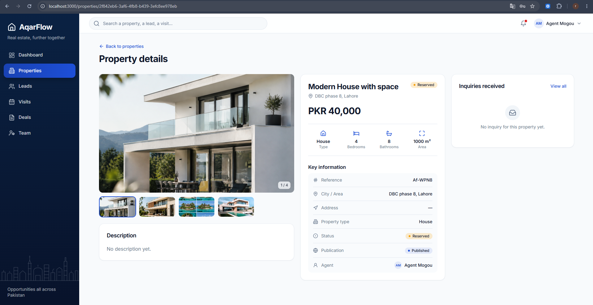
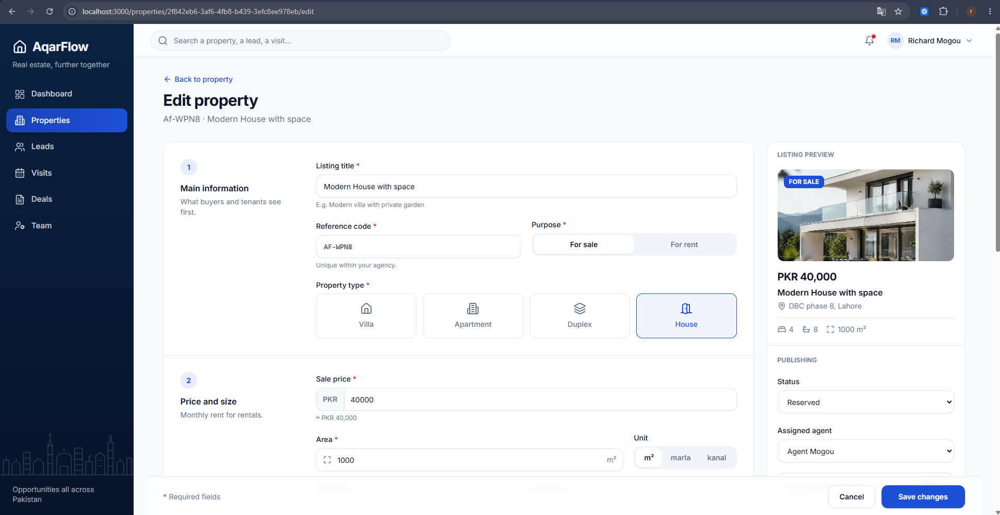
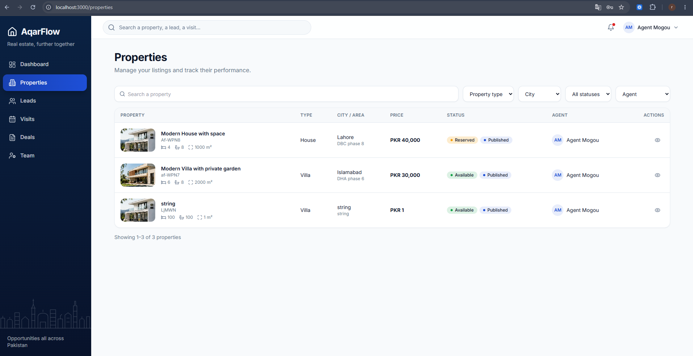
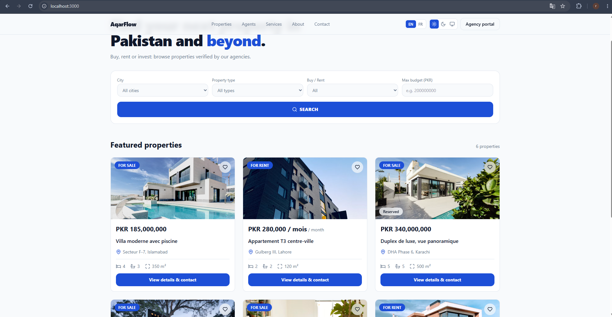
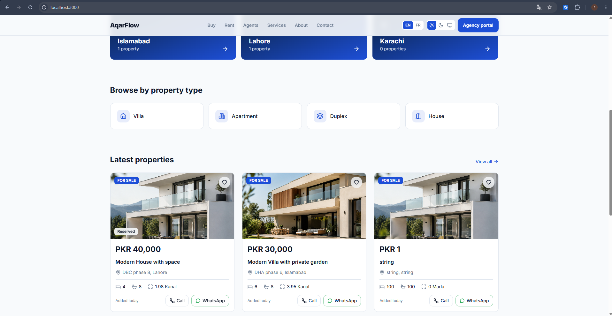
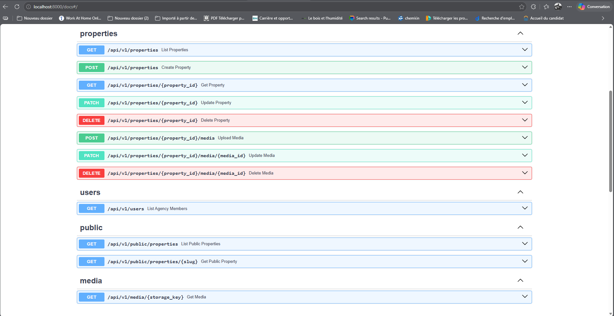

# Day 3 — Properties interface and public landing page

The workspace has a full properties list and property detail page connected to the real API. The public site has a landing page, a listings explorer and a property detail page with contact features.

## Properties list (`/properties`)

The properties list fetches data from `GET /api/v1/properties` server-side. It has a debounced search field and filters (property type, city, status, assigned agent) that update the URL via `router.replace` without a full page reload. The table shows each property with its cover photo, reference code, bedroom/bathroom/area specs, price, status badges, publication state and assigned agent. Pagination is handled server-side.

The **Add a property** button is visible to admins only and opens the creation form.

## Property detail (`/properties/[id]`)

A property page fetches `GET /api/v1/properties/{id}` server-side. It shows:

- **Photo gallery** — thumbnail strip with active indicator, counter badge.
- **Key information card** — reference, city/area, type, status badge, publication badge, assigned agent with avatar.
- **Description card** — free-text description from the database.
- **Inquiries card** — placeholder linking to `/leads`, ready to be wired up.

The **Edit** and **Publish/Unpublish** buttons are admin-only. `PublishButton` is a client component that calls `PATCH /api/v1/properties/{id}` and refreshes the page.

## Property form (`/properties/new` and `/properties/[id]/edit`)

A full multi-step creation and edit form with:

- **5 sections**: main info, price & size, location, description, photos.
- **Live preview sidebar** — updates in real time as the admin types (title, price, cover photo, location).
- **Photo management** — drag-and-drop upload, cover photo selection, remove existing photos. Validates JPEG/PNG/WebP, 5 MB max, 20 photos max per property. Photos are uploaded to `POST /api/v1/properties/{id}/media` after the property is saved.
- **Client-side validation** with field-level error messages.
- **API error mapping** — 409 conflict on reference code, 422 field errors, 403 admin guard.
- **Sticky save bar** at the bottom with Cancel and Save buttons.

## Public landing page (`/`)

The public landing page fetches live data from `GET /api/v1/public/properties`. It includes:

- **Hero section** with radial gradient background and `HeroSearch` client component.
- **Explore by city** — Islamabad, Lahore, Karachi cards with live property counts.
- **Browse by type** — Villa, Apartment, Duplex, House links.
- **Latest properties** — 3 most recent published listings using `PropertyCard`.
- **Why AqarFlow** — three value proposition cards.
- **Agency CTA** — banner linking to `/login`.

## API — Swagger

## Public listings explorer (`/listings`)

A full listings page with:

- **Sidebar filters** — buy/rent toggle, keyword search, city, property type, bedrooms, min/max price. Filters are debounced (400 ms) and update the URL.
- **Active filter chips** — each chip removes its filter on click.
- **Sort** — newest, price ascending, price descending.
- **Pagination** — previous/next and page number buttons.
- **List layout** `PropertyCard` with cover photo, specs, price and a link to the detail page.

## Public property detail (`/listings/[slug]`)

A full public property detail page with:

- **Breadcrumb** navigation (Home → For sale/rent → City → Title).
- **Photo gallery** reusing the workspace `Gallery` component.
- **Specs grid** — type, bedrooms, bathrooms, area, days listed.
- **Description** and **Location** cards.
- **Sticky contact sidebar** — agent avatar, Call and WhatsApp buttons (`ContactButtons`), inline inquiry form (`InquiryForm`).
- **Similar properties** — up to 3 properties from the same city and type.
- **JSON-LD** structured data for SEO.
- **`generateMetadata`** for dynamic `<title>` and `<description>`.

The legacy `/annonces/[slug]` route permanently redirects to `/listings/[slug]`.

## Known limitations

- The inquiry form (`InquiryForm`) submits to a backend endpoint not yet implemented.
- Property photos are stored on the local filesystem (`uploads/`); no cloud storage yet.
- The workspace property detail inquiries card is a placeholder until leads are connected.
