# Day 4 — Public portal

The public website is fully operational. Visitors can browse published properties, filter by purpose, city, type, price and bedrooms, view a full property detail page and submit an inquiry that creates a CRM lead.

## Acceptance criteria covered

| Criterion | Status |
|---|---|
| Public portal displays only published properties | ✅ |
| Property search with essential filters and pagination | ✅ |
| Visitor can submit an inquiry from a property page | ✅ |
| Inquiry is saved as a CRM lead linked to the correct property | ✅ |
| Responsive on desktop and mobile | ✅ |

---

## Public navbar

`PublicNavbar` is a sticky client component with:

- AqarFlow logo linking to `/`.
- Navigation links: Buy, Rent, Agents, Services, About, Contact (hidden below `lg`).
- `LocaleSwitcher` and `ThemeToggle` (hidden below `sm`).
- **Agency portal** button linking to `/login` (hidden below `sm`).
- Mobile burger menu — inline dropdown with all nav links plus Agency portal and locale/theme controls.

---

## Home page (`/`)

The home page fetches live data from `GET /api/v1/public/properties` server-side. It includes:

- **Hero section** — dark navy background with radial gradient and grid texture overlay. `HeroSearch` client component embedded in a card.
- **Explore by city** — Islamabad, Lahore, Karachi cards with live property counts from the API.
- **Browse by type** — Villa, Apartment, Duplex, House links to `/listings?type=…`.
- **Latest properties** — 3 most recent published listings using `PropertyCard`. Shows an empty state if no properties are published yet. Shows `ListingsUnavailable` if the API is unreachable.
- **Why AqarFlow** — three value proposition cards (reviewed listings, direct agent contact, local expertise).
- **Agency CTA** — full-width banner linking to `/login`.

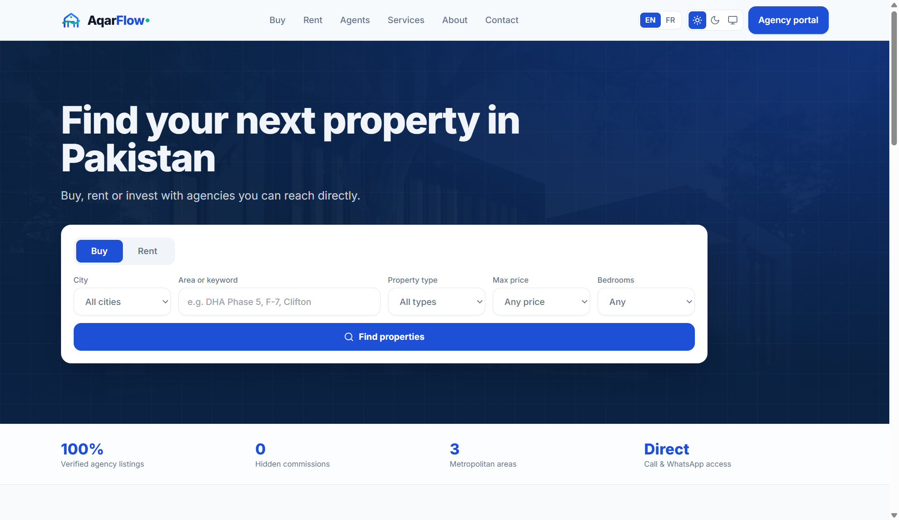
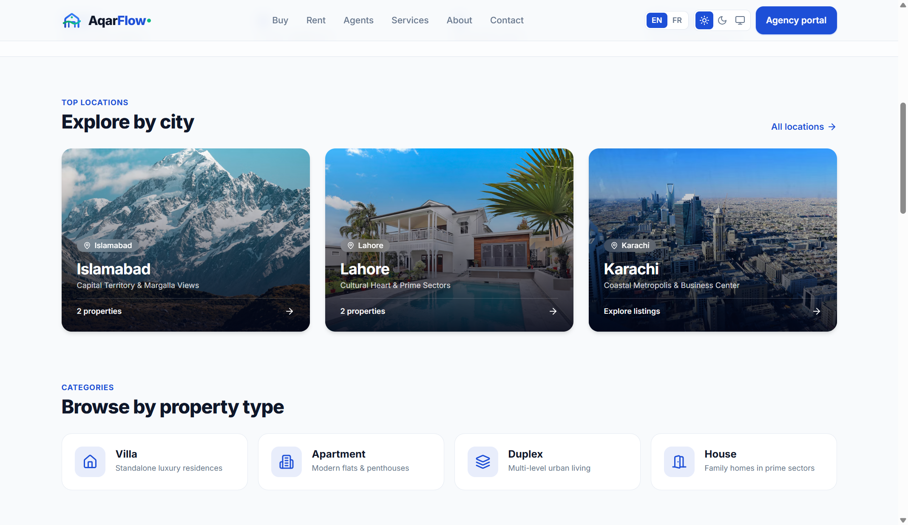

### HeroSearch

`HeroSearch` is a client component with a Buy/Rent toggle and a 6-column form:

- City select (Islamabad, Lahore, Karachi).
- Area or keyword text input.
- Property type select.
- Max price select (amounts adapt to sale vs rent).
- Bedrooms select (1+, 2+, 3+, 4+, 5+).
- Find properties submit button → redirects to `/listings?…`.

---

## Listings page (`/listings`)

`GET /api/v1/public/properties` is called server-side with filters parsed from URL search params. Results are passed to `ListingsExplorer`. If the API is unreachable, `ListingsUnavailable` is shown instead.

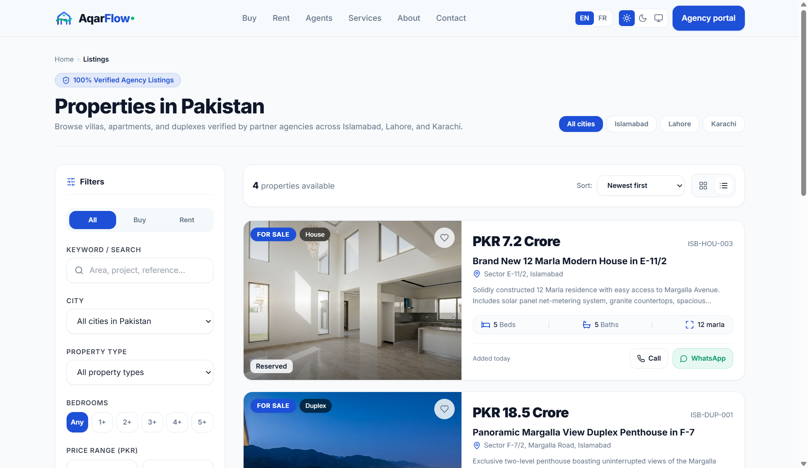
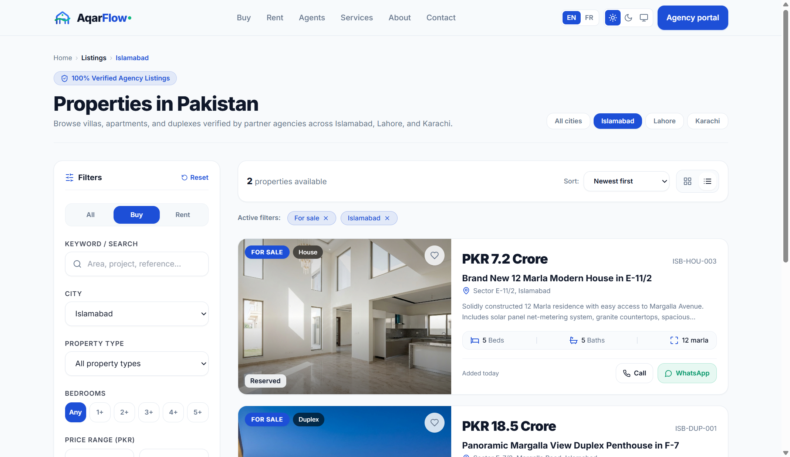

### ListingsExplorer

`ListingsExplorer` is a client component with:

- **Sidebar filters** (sticky on desktop, collapsible on mobile):
  - Buy / Rent / All radio toggle.
  - Keyword text input.
  - City select.
  - Property type select.
  - Bedrooms buttons (Any, 1+, 2+, 3+, 4+, 5+).
  - Min/max price inputs with formatted preview.
  - Reset all filters link.
- **Active filter chips** — each chip removes its filter on click.
- **Sort** — newest, price ascending, price descending.
- **Results count** with `aria-live`.
- **List layout** `PropertyCard` with cover photo, specs, price and link to detail page.
- **Pagination** — previous/next and numbered page buttons.
- Filters are debounced (400 ms) and update the URL via `router.replace` without a full page reload.

---

## Property detail page (`/listings/[slug]`)

`GET /api/v1/public/properties/{slug}` is called server-side. 404 → `notFound()`. API error → `ListingsUnavailable`.

The page includes:

- **JSON-LD** structured data (`RealEstateListing`) for SEO.
- **`generateMetadata`** for dynamic `<title>` and `<meta description>`.
- **Breadcrumb** — Home › For sale/rent › City › Property title.
- **Title, location, reference code** and status badge (if not available).
- **Price** — formatted in PKR with full amount tooltip; "/ month" suffix for rentals.
- **Photo gallery** — reuses the workspace `Gallery` component (thumbnail strip, counter badge). Shows a placeholder if no photos.
- **Specs grid** — Type, Bedrooms, Bathrooms, Area, Days listed (Today / Yesterday / N days ago).
- **Description card** — free-text from the database, or a fallback message.
- **Location card** — city and locality; map placeholder.
- **Sticky contact sidebar**:
  - Agent avatar and name if assigned.
  - `ContactButtons` — Call (tel: link) and WhatsApp (wa.me link with pre-filled message).
  - `InquiryForm` — full contact form.
  - Legal disclaimer.
- **Similar properties** — up to 3 properties from the same city and type.

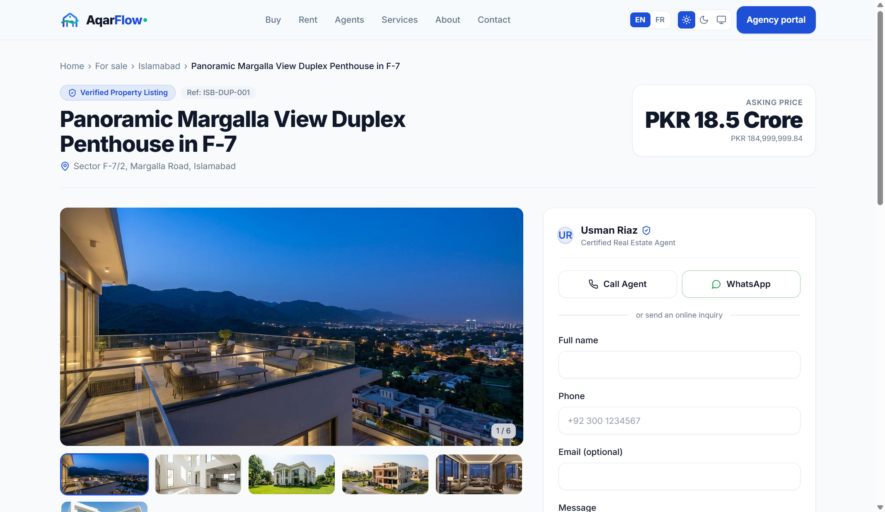
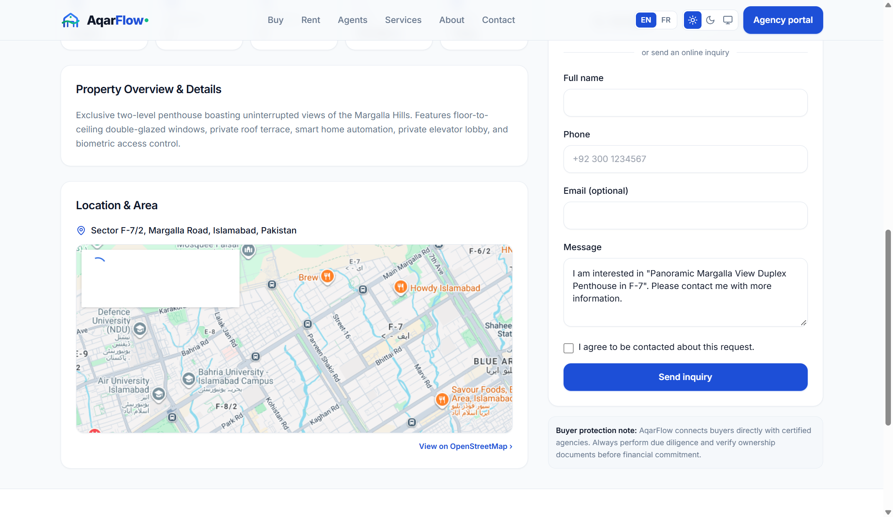
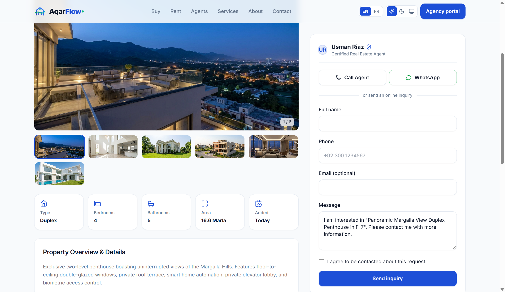

### InquiryForm

`InquiryForm` is a client component that posts to `POST /api/v1/public/inquiries`:

- Fields: full name, phone (normalized), email (optional), message (pre-filled with property title), consent checkbox.
- Honeypot field (`website`) for spam protection — hidden off-screen, not in tab order.
- Client-side validation with field-level error messages.
- API error mapping: 404 (listing no longer available), 422 (invalid data), generic network error.
- Success state with a "Send another message" button.

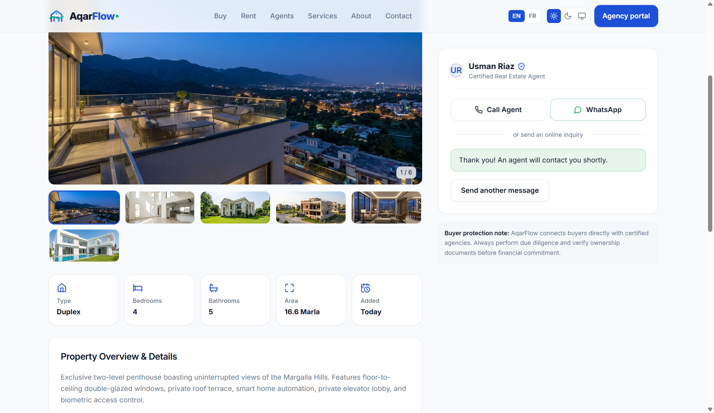

## Public footer

`PublicFooter` is a 4-column server component with:

- AqarFlow brand mark, mission statement and direct contact channels (Islamabad address, phone link, email, and WhatsApp direct support).
- Properties column: quick links for sale, rent, Islamabad, Lahore, Karachi.
- Property types column: luxury villas, modern apartments, duplexes & penthouses, commercial spaces, and certified agents.
- Company column: About us, Services, Contact, and Agency portal login.
- Legal & regulatory compliance bottom bar with copyright and Pakistani provincial real estate disclaimer.

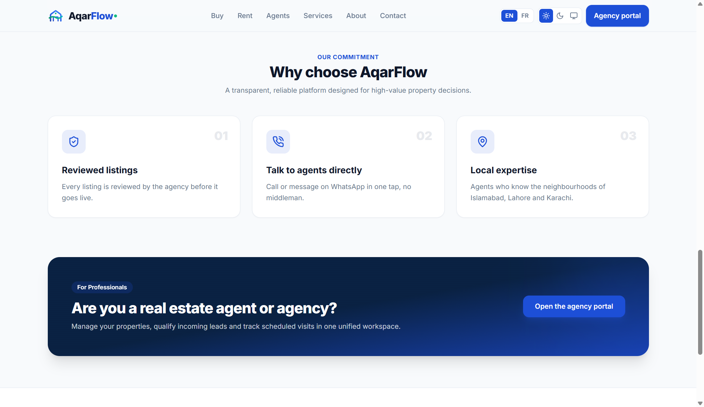

---

## Design system & branding enhancements

- **SVG logo & mark**: Custom vector monogram component (`Logo` and `LogoMark` in `components/logo.tsx`, plus static assets in `public/logo.svg` and `public/logo-mark.svg`) combining the architectural structure ("Aqar") and dynamic upward flow ribbon ("Flow").
- **Architectural blueprint background**: CSS utility `.bg-grid-blueprint` on `body` combining a 36×36px micro-grid at 3.5% adaptive opacity with ambient radial light halos, anchored with `bg-fixed`.
- **PropertyCard**: Aspect ratio `16/10` with smooth zoom on hover, high-contrast purpose badges, frosted glass property type pill, favorite button, formatted specs row (beds, baths, area), and direct Call/WhatsApp action buttons. Supports both grid and list layouts.

---

## Backend — public inquiries endpoint

`POST /api/v1/public/inquiries` accepts the inquiry form payload, validates and normalizes the phone number to E.164, creates a `Contact` record and a `Lead` record linked to the property (looked up by slug). The lead is created with stage `new` and source `website`. Spam requests caught by the honeypot field are rejected.

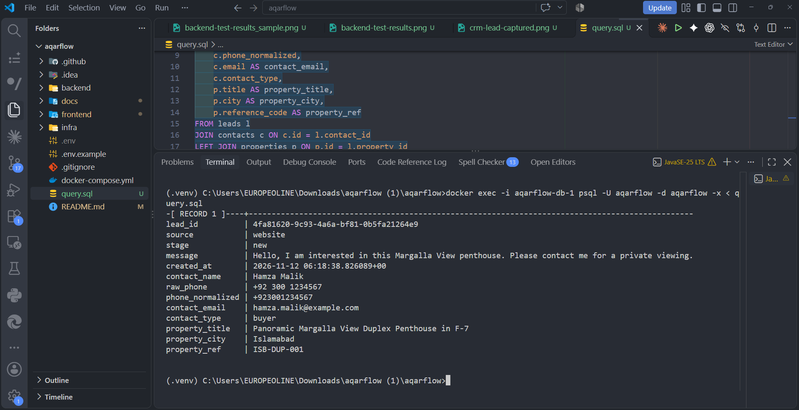

---

## Resolved improvements

- **Interactive location map**: The property detail page features an embedded responsive map centered on the property locality and city, with a link to OpenStreetMap.
- **Direct agent phone**: `PublicPropertyOut` exposes the assigned agent's phone number, enabling direct one-tap calling and WhatsApp messaging to the specific listing agent.

---

## Automated tests

- Full backend test suite passing on PostgreSQL database: `51 passed, 1 skipped` (`pytest tests -q`).
- Frontend TypeScript type check (`npx tsc --noEmit`) and ESLint (`npm run lint`): 0 errors, 0 warnings.

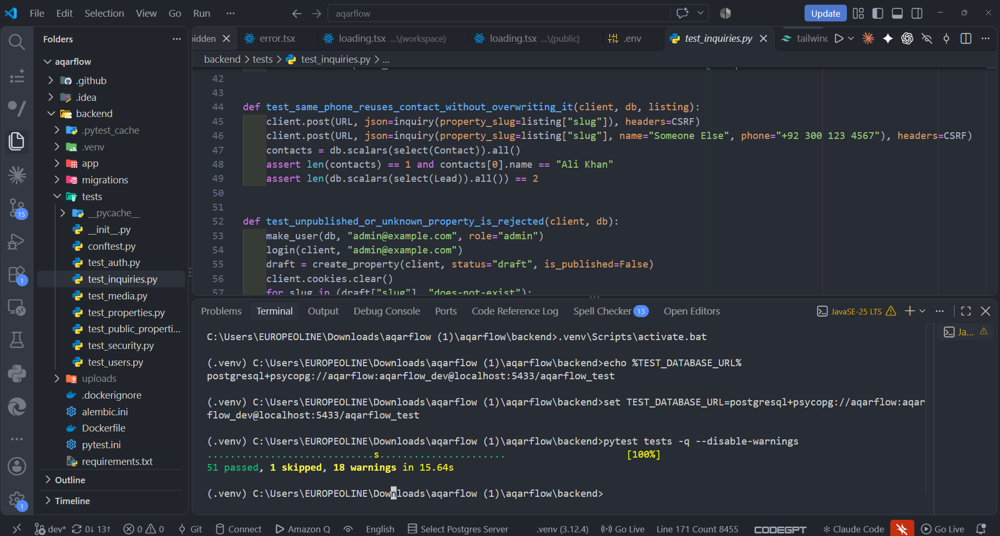

---

## Scope boundaries (Phase 2)

- Customer registration, saved properties and visitor inquiry history are scheduled for Phase 2 as per specification section 15.
