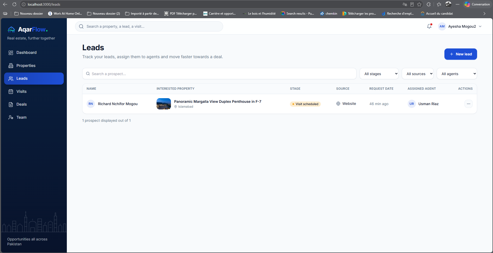
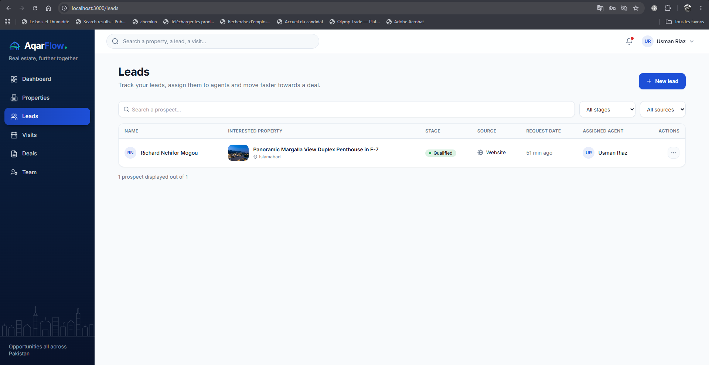
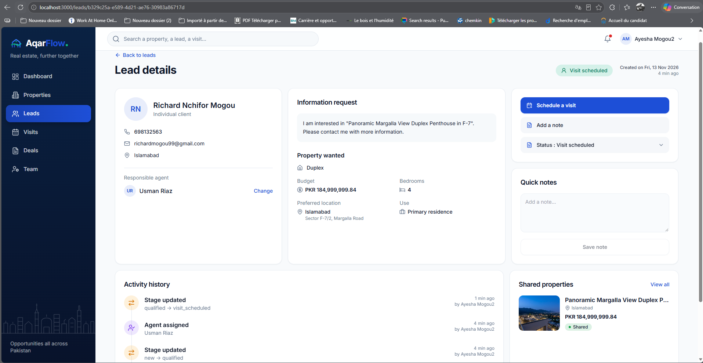
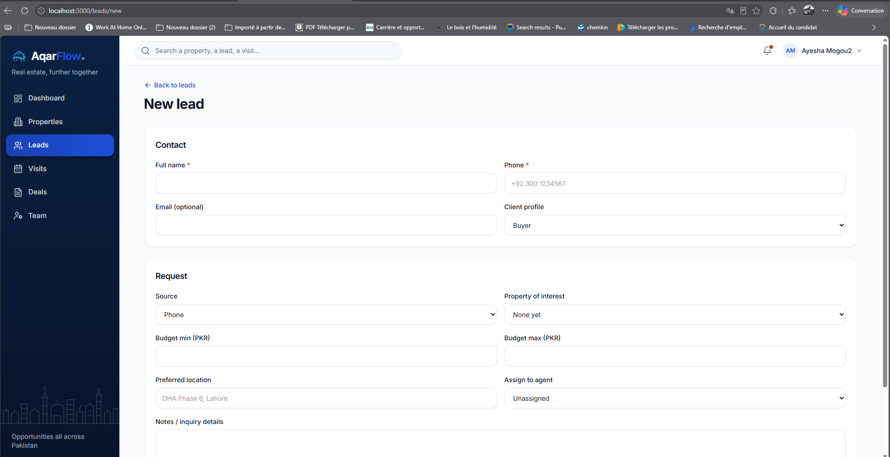
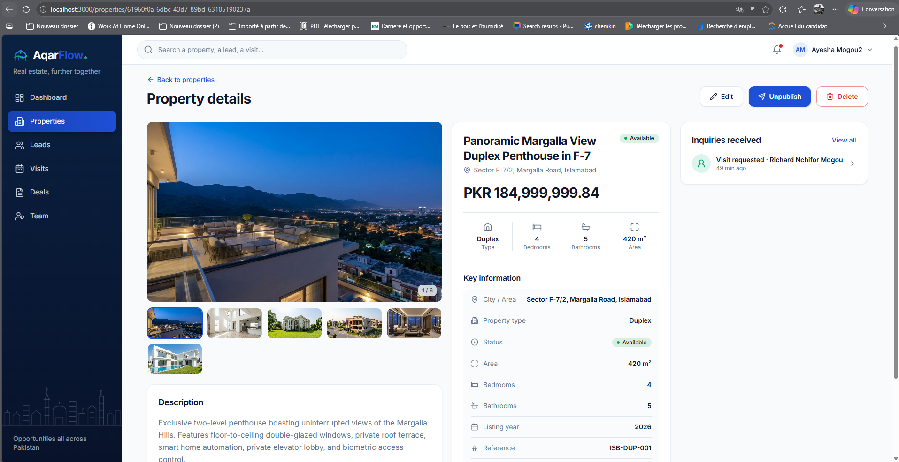
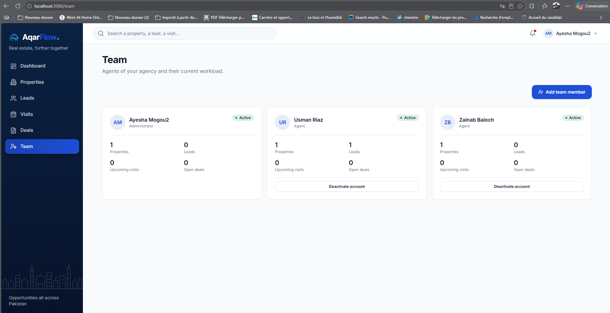
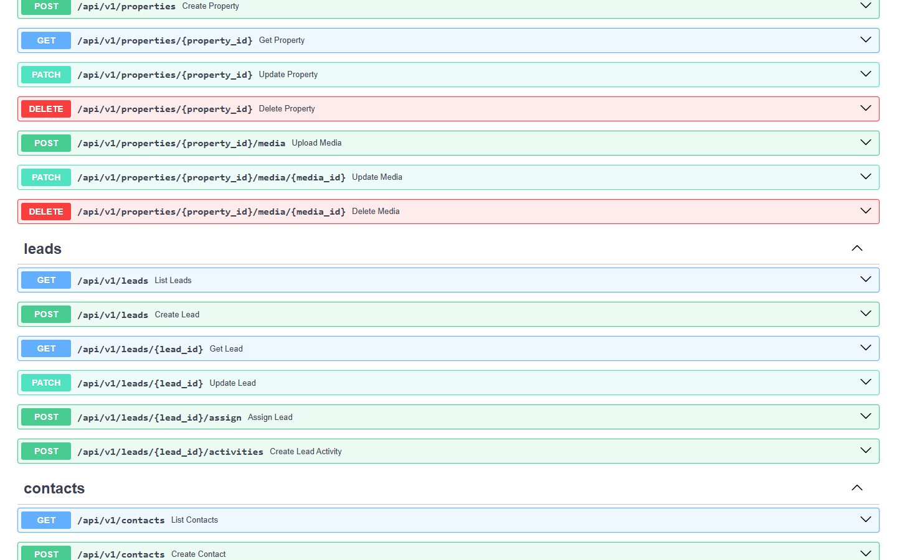

try# Day 5 — CRM, leads and team management

The internal workspace CRM and agent management workflows are connected to the live API. Agency administrators and agents can track public inquiries and manual leads, manage contact profiles, assign leads to agents, record follow-up notes, progress leads through pipeline stages and monitor team workload.

## Acceptance criteria covered

| Criterion | Status |
|---|---|
| Public inquiries and manual entries are stored as CRM leads linked to contacts and properties | ✅ |
| Admin can assign and reassign a lead to an Agent | ✅ |
| Agent can view only assigned leads, add notes and update lead stage | ✅ |
| Cross-agency isolation and role-based access control enforced on leads, contacts and team endpoints | ✅ |
| Admin can view agent workload, create staff accounts and activate/deactivate members | ✅ |

---

## Leads list (`/leads`)

`GET /api/v1/leads` is called server-side with search and filter parameters parsed from the URL. Results and active agency members (`GET /api/v1/users`) are passed to `LeadsTable`.

### LeadsTable

`LeadsTable` (`features/leads/leads-table.tsx`) is a client component with:

- **Debounced search** (300 ms) matching contact name, phone, email, preferred location, or linked property title, reference code and city.
- **Stage filter** — `new`, `contacted`, `qualified`, `visit_scheduled`, `negotiation`, `converted`, `lost`.
- **Source filter** — `website`, `phone`, `whatsapp`, `instagram`.
- **Agent filter** (admin only) — filter by specific agent or show unassigned leads (`unassigned=true`).
- **Inline agent assignment** (admin only) — unassigned rows provide an inline **Assign to an agent** selector that posts to `POST /api/v1/leads/{id}/assign` and refreshes the view.
- **Server-side pagination** with URL state updates via `router.replace`.

### Agent-scoped view

When signed in as an `agent`, `GET /api/v1/leads` automatically scopes results to `Lead.assigned_agent_id == current_user.id`. Unassigned leads and leads assigned to other agents are hidden from the list and rejected with `HTTP 403` on direct access.

---

## Lead detail (`/leads/[id]`)

`GET /api/v1/leads/{id}` fetches the lead, its linked `Contact`, its linked `Property` (with cover media) and its chronological `Activity` timeline.

The page includes:

- **Contact card** — avatar, full name, client profile (`buyer`, `tenant`, `seller`, `landlord`), clickable `tel:` (normalized E.164) and `mailto:` links, city, and `LeadAgentSelect` allowing admins to assign or change the responsible agent.
- **Information request & Property wanted card** — inquiry message, property type, formatted PKR budget range (`budget_min` – `budget_max`), bedrooms, preferred location and purpose.
- **LeadActions sidebar** (`features/leads/lead-actions.tsx`):
  - **Schedule a visit** button linking to `/visits/new?lead={id}`.
  - **Add a note** shortcut focusing the quick note composer.
  - **Stage selector** calling `PATCH /api/v1/leads/{id}` and recording a `stage_change` activity (`old_stage -> new_stage`).
  - **Quick notes** card posting to `POST /api/v1/leads/{id}/activities` with `activity_type: "note"`.
- **Activity history timeline** — chronological log of notes, calls, agent assignments and stage transitions with relative timestamps and actor attribution.
- **Shared properties card** — thumbnail, title, city, PKR price and link to `/properties/{id}` when a property is linked.

---

## Manual lead creation (`/leads/new`)

`LeadForm` (`features/leads/lead-form.tsx`) allows staff to register walk-in, phone, WhatsApp or Instagram leads via `POST /api/v1/leads`:

- **Contact section** — full name, phone (validated and normalized to E.164), optional email, client profile (`buyer`, `tenant`, `seller`, `landlord`).
- **Request section** — lead source, optional property of interest from the agency inventory, min/max budget in PKR (validated so `budget_max >= budget_min`), preferred location, responsible agent (admin only; agents are automatically assigned to leads they create) and notes.
- Reuses an existing agency contact when `phone_normalized` matches, avoiding duplicate contact records.

---

## Property detail & Dashboard integration

- **Property detail (`/properties/[id]`)** — the **Inquiries received** card is wired to `GET /api/v1/leads?property_id={id}&page_size=5`, displaying live leads linked to that property with stage context and direct links to `/leads/{lead_id}`.
- **Workspace dashboard (`/dashboard`)** — the **New leads** KPI card fetches live counts from `GET /api/v1/leads?stage=new` and `GET /api/v1/leads?unassigned=true`.

---

## Team & agent workload (`/team`)

`TeamManager` (`features/team/team-manager.tsx`) connects to `GET /api/v1/users/team`, `POST /api/v1/users` and `PATCH /api/v1/users/{id}`:

- Displays every member of the agency with role badge, active status, phone number and live workload counters:
  - Assigned properties (`properties_count`)
  - Assigned leads (`leads_count`)
  - Upcoming visits (`upcoming_visits_count`)
  - Open deals (`open_deals_count`)
- **Add team member** form (admin only) — creates an `agent` or `admin` user in the administrator's agency with Argon2 password hashing and duplicate email conflict handling (`HTTP 409`).
- **Activate / Deactivate account** (admin only) — toggles `is_active` via `PATCH /api/v1/users/{id}` and immediately revokes all active sessions when a user is deactivated; prevents an admin from deactivating or demoting their own account (`HTTP 422`).

---

## Backend CRM & Contacts API

- **Leads (`app/api/v1/leads.py`)**:
  - `GET /api/v1/leads` — paginated list with search (`q`), `stage`, `source`, `property_id`, `assigned_agent_id`, `unassigned` and `sort` (`newest` / `oldest`).
  - `POST /api/v1/leads` — creates or reuses a normalized `Contact`, creates the `Lead` and logs an initial `assignment` activity if assigned.
  - `GET /api/v1/leads/{lead_id}` — returns lead detail with `contact`, `property` and ordered `activities`.
  - `PATCH /api/v1/leads/{lead_id}` — updates lead fields and automatically records `stage_change` and `assignment` activities.
  - `POST /api/v1/leads/{lead_id}/assign` — admin-only endpoint to assign or unassign an active agency member.
  - `POST /api/v1/leads/{lead_id}/activities` — appends a `note` or `call` activity attributed to the signed-in user.
- **Contacts (`app/api/v1/contacts.py`)**:
  - `GET /api/v1/contacts`, `POST /api/v1/contacts`, `GET /api/v1/contacts/{contact_id}`, `PATCH /api/v1/contacts/{contact_id}` with E.164 phone uniqueness per agency and agent access restricted to contacts linked to their assigned leads.
- **Users & Team (`app/api/v1/users.py`)**:
  - `GET /api/v1/users`, `GET /api/v1/users/team`, `POST /api/v1/users`, `PATCH /api/v1/users/{member_id}`.

---

## Automated tests

- Backend test suite (`pytest tests -v`): **58 passed, 1 skipped** (including `tests/test_leads.py` and `tests/test_users.py` covering inquiry-to-lead assignment, agent RBAC restrictions, self-assignment on agent lead creation, cross-agency isolation, filters, contact deduplication and team workload/deactivation).
- Frontend TypeScript type check (`npx tsc --noEmit`) and ESLint (`npm run lint`): **0 errors, 0 warnings**.

---

## Known limitations

- Visits (`/visits`) and deals (`/deals`) pages still use mock data in the frontend and will be connected to their backend endpoints on Day 6.
