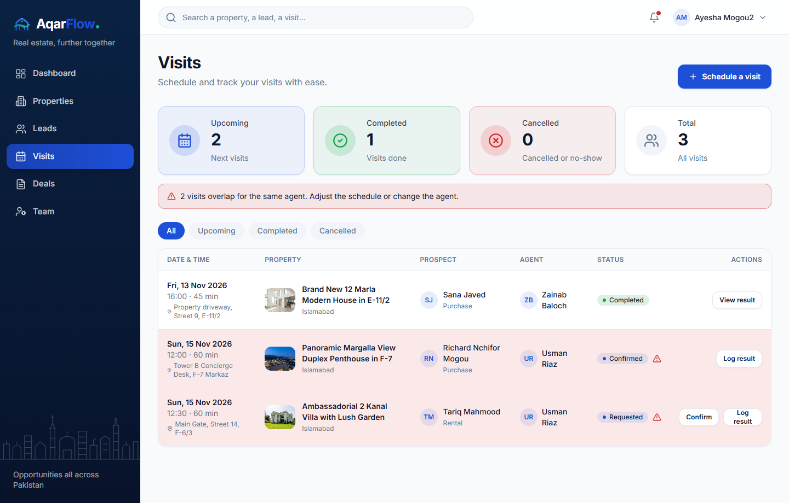
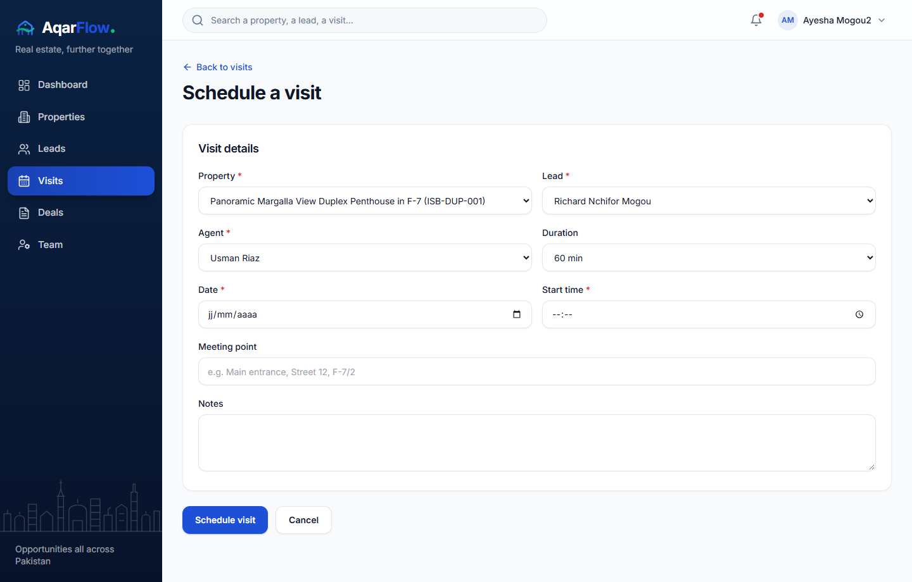
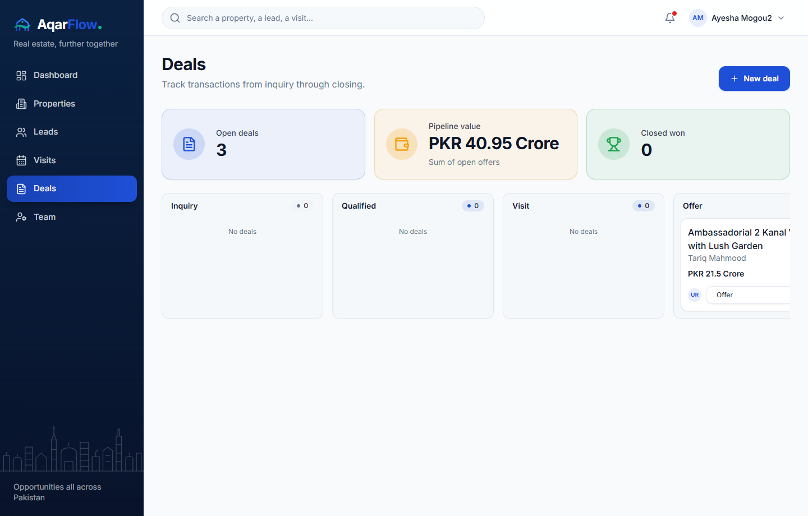
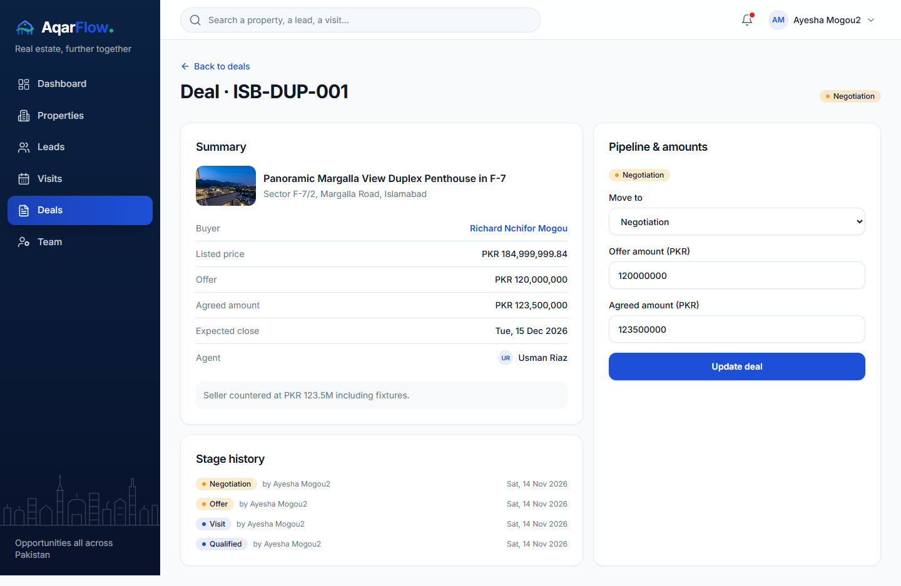
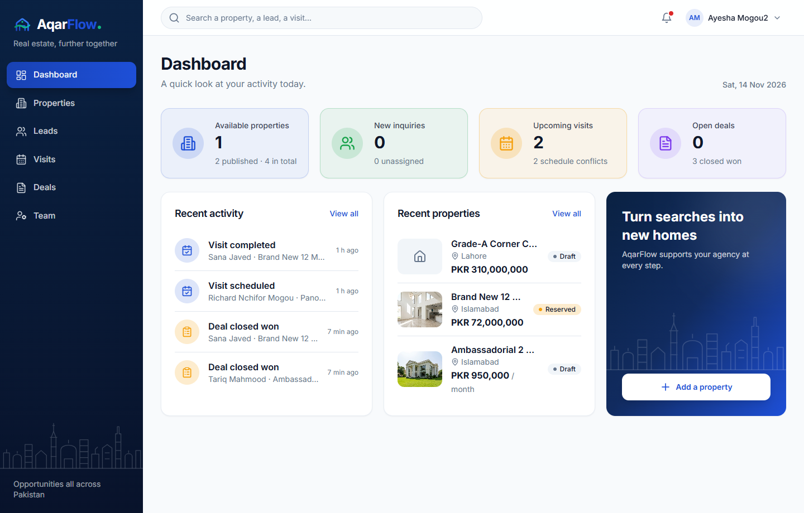
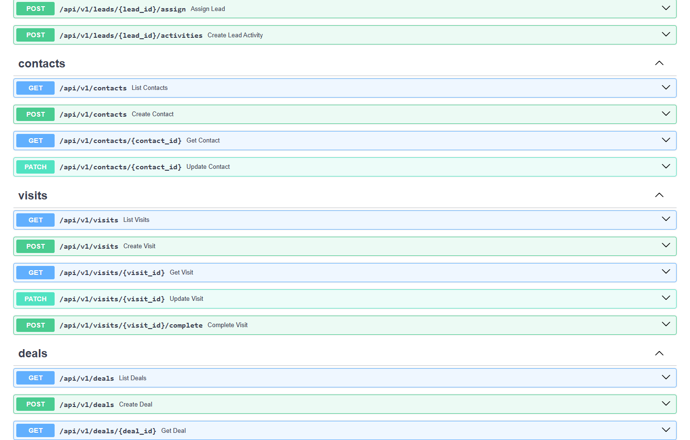

# Day 6 — Visits, deal pipeline and live dashboard

The workspace visit scheduling, deal pipeline and overview dashboard are connected to the live API. Agency administrators and agents can schedule property visits with automatic agent conflict warnings, record visit outcomes, create and progress deals across the 9-stage Kanban board with full stage history, and view live KPI counts and recent activity on the dashboard.

## Acceptance criteria covered

| Criterion | Status |
|---|---|
| Authorized user can create a property visit and update its status | ✅ |
| Clear warning displayed for an agent scheduling conflict (in form and visits table) | ✅ |
| Authorized user can create a deal record linked to a property, lead and responsible agent | ✅ |
| Deal stage transitions are recorded in `deal_events` history; duplicate `closed_won` deals on the same property are prevented (`HTTP 409`) | ✅ |
| Dashboard displays accurate live counts for available/published properties, new leads, upcoming visits (with conflicts) and open deals | ✅ |

---

## Visits management (`/visits`)

`GET /api/v1/visits` is called server-side and returns `VisitPage` with all agency visits (or agent-scoped visits for non-admins), pre-computed overlap conflicts and summary counts (`upcoming_count`, `completed_count`, `cancelled_count`, `conflict_count`).

### VisitsView

`VisitsView` (`features/visits/visits-view.tsx`) includes:

- **4 KPI stat cards** — Upcoming (`requested` + `confirmed`), Completed, Cancelled (`cancelled` + `no_show`) and Total visits.
- **Schedule conflict banner** — displayed automatically when two or more active visits (`requested` / `confirmed`) for the same agent overlap in time, with row highlighting and warning badges on the conflicting rows.
- **Category tabs** — All, Upcoming, Completed, Cancelled.
- **Confirm action** — one-click confirmation button for `requested` visits (`PATCH /api/v1/visits/{id}`).
- **Inline outcome drawer (`Log result` / `View result`)** — expands inline to set the final status (`completed`, `cancelled`, `no_show`) and record the visit outcome (`POST /api/v1/visits/{id}/complete`), which also appends a note to the lead's activity history.

---

## Scheduling a visit (`/visits/new`)

`VisitForm` (`features/visits/visit-form.tsx`) fetches the agency's properties, leads, active members and upcoming visits:

- Pre-fills the property and responsible agent when navigated from a lead detail page (`/visits/new?lead={id}`).
- Checks for overlapping active visits in real time as the user selects the agent, date, start time and duration (30, 45, 60 or 90 minutes) and displays a non-blocking warning banner with the conflicting property title and start time.
- Submits to `POST /api/v1/visits`, automatically advancing the linked lead's stage to `visit_scheduled` and logging the scheduled visit in the lead's activity timeline.

---

## Deals pipeline Kanban (`/deals`)

`GET /api/v1/deals` returns `DealPage` with all deals in scope, `open_count`, `closed_won_count` and `pipeline_value` (sum of `coalesce(agreed_amount, offer_amount)` across all open deals).

### DealsBoard

`DealsBoard` (`features/deals/deals-board.tsx`) provides:

- **3 KPI stat cards** — Open deals count, total Pipeline value formatted in PKR, and Closed won count.
- **9-stage Kanban board** — `inquiry`, `qualified`, `visit`, `offer`, `negotiation`, `booking`, `documentation`, `closed_won`, `closed_lost`.
- Each card links to `/deals/{id}`, displays the property title, buyer name, offer/agreed amount in PKR, responsible agent avatar and an inline stage selector that posts to `POST /api/v1/deals/{id}/stage`.
- Displays an error banner if a user attempts to mark a second deal as `closed_won` on a property that already has a confirmed sale (`HTTP 409`).

---

## Creating a deal (`/deals/new`) & Deal detail (`/deals/[id]`)

- **New deal form (`/deals/new`)** — selects a lead (or pre-fills from `/deals/new?lead={id}`), links the property and responsible agent, sets the initial stage, offer amount in PKR, expected close date and notes, and posts to `POST /api/v1/deals`. Warns if the lead is not yet qualified or already has an open deal.
- **Deal detail (`/deals/[id]`)** — shows the linked property card, buyer contact link, listed price, offer amount, agreed amount, expected close date, responsible agent, chronological `deal_events` stage history and the `DealStage` sidebar component (`features/deals/deal-stage.tsx`) to update the stage, offer amount and agreed amount.

---

## Workspace dashboard (`/dashboard`)

`DashboardPage` (`app/(workspace)/dashboard/page.tsx`) now fetches all 4 KPI metrics and the recent activity feed from the live backend API:

- **Available properties** — `GET /api/v1/properties?is_published=true&status=available`
- **New inquiries** — `GET /api/v1/leads?stage=new` & `unassigned=true`
- **Upcoming visits** — `GET /api/v1/visits` (`upcoming_count` and `conflict_count` hint)
- **Open deals** — `GET /api/v1/deals` (`open_count` and `closed_won_count` hint)
- **Recent activity** — live feed combining recent visits, deals and lead inquiries with direct links.

---

## Backend Visits & Deals API

- **Visits (`app/api/v1/visits.py`)**:
  - `GET /api/v1/visits` — list visits with `status_filter`, `group` (`all`, `upcoming`, `done`, `cancelled`), `agent_id`, `property_id`, `lead_id`, conflict detection and summary counters.
  - `POST /api/v1/visits` — create a visit, transition lead stage to `visit_scheduled` and log a lead activity.
  - `GET /api/v1/visits/{visit_id}` — retrieve visit details with conflict status.
  - `PATCH /api/v1/visits/{visit_id}` — update visit schedule, agent (admin only), status, meeting point, notes or outcome.
  - `POST /api/v1/visits/{visit_id}/complete` — record visit completion (`completed`, `cancelled`, `no_show`) and outcome note.
- **Deals (`app/api/v1/deals.py`)**:
  - `GET /api/v1/deals` — list deals with `stage`, `property_id`, `lead_id`, `agent_id` filters and pipeline totals.
  - `POST /api/v1/deals` — create a deal linked to a lead, property, buyer contact and agent, recording the initial `DealEvent`.
  - `GET /api/v1/deals/{deal_id}` — retrieve deal detail with chronological `DealEvent` history.
  - `PATCH /api/v1/deals/{deal_id}` & `POST /api/v1/deals/{deal_id}/stage` — update deal amounts/notes and transition stages while enforcing single `closed_won` per property and converting the lead on `closed_won`.

---

## Automated tests

- Backend test suite (`pytest tests -v`): **62 passed, 1 skipped** (including `tests/test_visits.py` and `tests/test_deals.py`).
- Frontend TypeScript type check (`npx tsc --noEmit`) and ESLint (`npm run lint`): **0 errors, 0 warnings**.
