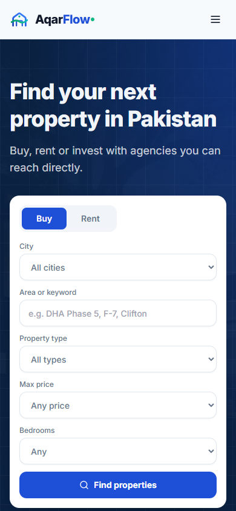
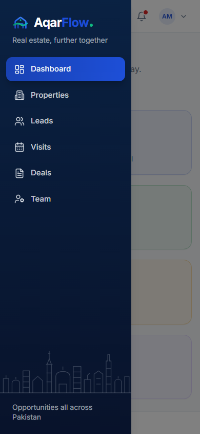
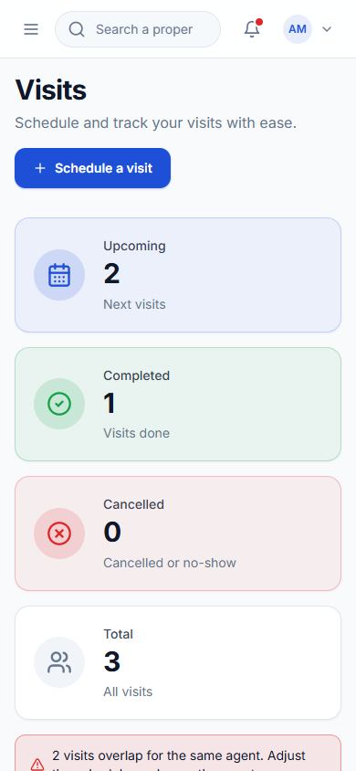
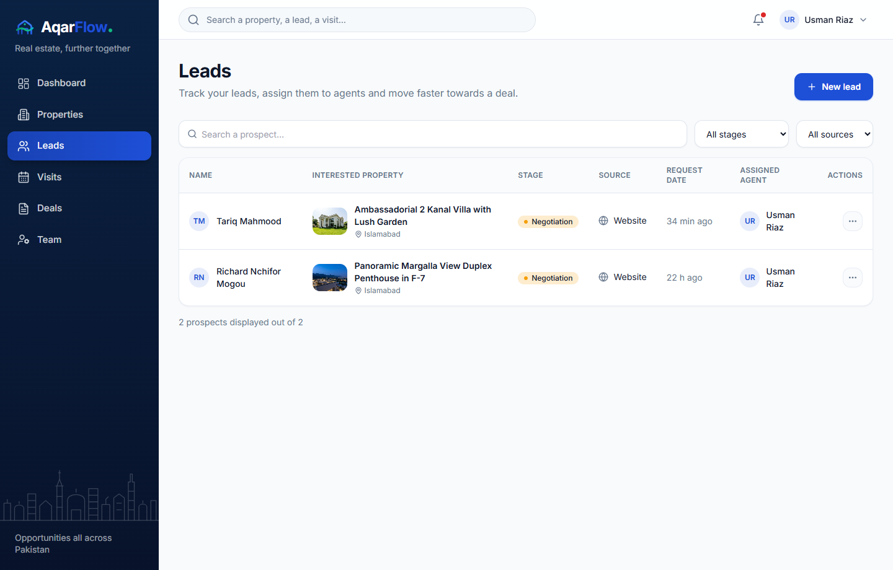
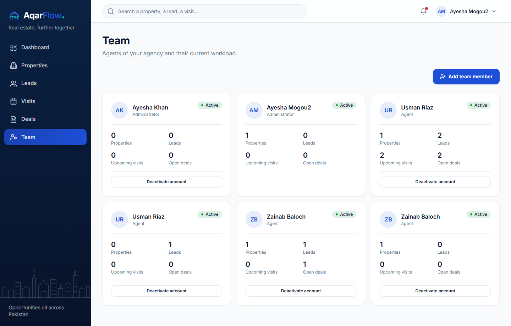

# Day 7 — QA, Responsive Verification, Demo Seeding & Release Readiness

**Date**: 2026-11-14  
**Scope**: End-to-end MVP acceptance testing, idempotent demo data CLI (`seed-demo`), responsive mobile/desktop verification across public and workspace views, full container deployment configuration (`Dockerfile` + `docker-compose.yml`), API reference, user guides, and handover documentation.

---

## 1. Deliverables Completed

### 1.1 Idempotent Demo Data Seeding (`python -m app.cli seed-demo`)
- Extended [`backend/app/cli.py`](../../backend/app/cli.py) with `seed_demo_data()` and the `seed-demo` CLI subcommand.
- Provisions the demo agency **Islamabad Capital Towers** (`islamabad-capital-towers`, currency `PKR`), 1 Admin (`admin@aqarflow.pk`) + 2 Agents (`usman.riaz@aqarflow.pk`, `zainab.baloch@aqarflow.pk`), 4 properties (published & draft across Islamabad and Lahore), 3 contacts & CRM leads with qualification notes, 3 visits (including 2 overlapping visits demonstrating agent conflict detection + 1 completed visit), and 2 deals with `deal_events` stage history.
- Verified idempotency via automated test `test_seed_demo_data_is_idempotent`.

### 1.2 End-to-End MVP Acceptance Test Suite (`backend/tests/test_acceptance_mvp.py`)
- Created [`backend/tests/test_acceptance_mvp.py`](../../backend/tests/test_acceptance_mvp.py) validating all Section 16 acceptance criteria in a single full-stack flow:
  1. Unauthenticated workspace requests (`GET /api/v1/properties`, `/leads`, `/visits`, `/deals`) return `401 Unauthorized`.
  2. Admin signs in (`204 No Content`, `HttpOnly` session cookie) and creates published (`available`) and unpublished (`draft`) properties.
  3. Public catalog (`GET /api/v1/public/properties`) returns only published properties and supports city/purpose filtering; `GET /api/v1/public/properties/{slug}` returns full public details without leaking internal UUIDs.
  4. Public visitor submits an inquiry (`POST /api/v1/public/inquiries`); phone number is normalized (`+923007788990`) and a CRM lead is created in stage `new`.
  5. Admin assigns the lead to Agent 1; Agent 2 is blocked (`403 Forbidden`) from viewing Agent 1's lead; Agent 1 logs a call activity and advances the lead stage to `qualified`.
  6. Agent 1 schedules a confirmed visit, schedules an overlapping second visit (`has_conflict: true` and `conflicting_visit_ids` populated), and completes the first visit with outcome notes.
  7. Agent 1 creates a deal (`offer`), advances it to `closed_won`, and verifies that a second `closed_won` deal on the same property is rejected (`409 Conflict`).
  8. Summary counts across `/api/v1/deals` and `/api/v1/visits` accurately reflect open, completed, conflict, and closed-won totals.

### 1.3 Frontend UX Polish & Container Deployment
- Connected the workspace topbar search input ([`frontend/components/layout/topbar.tsx`](../../frontend/components/layout/topbar.tsx)) to `/properties?q=...`.
- Added production multi-stage [`frontend/Dockerfile`](../../frontend/Dockerfile) and registered the `frontend` service in [`docker-compose.yml`](../../docker-compose.yml) alongside `db`, `minio`, and `backend`.
- Cleaned up untracked empty Alembic migration file so `alembic heads` and `alembic current` match `c3d4e5f6a7b8 (head)`.

### 1.4 Documentation & Handover Package (Section 17)
- Updated root [`README.md`](../../README.md) with complete architecture, local & Docker setup, environment variables, CLI demo seeding, test suite execution, and Day 1–7 index.
- Added [`docs/api/endpoints.md`](../api/endpoints.md) documenting all API v1 endpoints and request payloads.
- Added [`docs/user-guides/admin-and-agent-guide.md`](../user-guides/admin-and-agent-guide.md) covering the RBAC permission matrix and daily workflows for Admins and Agents.
- Added [`docs/architecture/handover-and-limitations.md`](../architecture/handover-and-limitations.md) documenting the security posture, third-party dependencies, known MVP limitations, and Phase 2 scope boundary.

---

## 2. Verification & QA Results

- **Backend Test Suite**: `64 passed, 1 skipped` (`pytest tests -v`).
- **Frontend Type & Lint Checks**: `npx tsc --noEmit` (`0 errors`) and `npm run lint` (`✔ No ESLint warnings or errors`).
- **Responsive Layout Verification**: Verified mobile (`390×844`) and desktop (`1440×920`) viewports across the public home page, public property detail page, workspace dashboard with mobile navigation drawer, deals board, and agent restricted view.

---

## 3. Screenshots (`docs/screenshots/day-7/`)

| Screenshot | Description |
|---|---|
|  | Public portal home page on mobile viewport (`390×844`) |
|  | Public property detail & inquiry form on mobile viewport (`390×844`) |
|  | Workspace dashboard with responsive slide-over navigation drawer (`390×844`) |
|  | Visits schedule & conflict banner on mobile viewport (`390×844`) |
|  | Agent-scoped CRM view (`Usman Riaz` seeing only his assigned leads) |
|  | Admin team roster & account activation controls (`/team`) |
